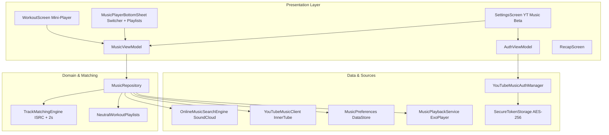

# M6 YouTube Music (Beta) + Music Switcher Utuh Implementation Plan

> **For agentic workers:** REQUIRED SUB-SKILL: Use superpowers:subagent-driven-development (recommended) or superpowers:executing-plans to implement this plan task-by-task. Steps use checkbox (`- [ ]`) syntax for tracking.

**Goal:** Mengimplementasikan integrasi YouTube Music (Beta / Tidak Resmi) di balik feature flag bersama SoundCloud (fallback stabil) dan Music Switcher `SoundCloud ↔ YouTube Music` tanpa me-reset tracking olahraga, serta menghapus Spotify dari UI sesuai keputusan pemilik.

**Architecture:** `MusicRepositoryImpl` berperan sebagai koordinator tunggal di atas dua sumber musik aktif yang terisolasi (`OnlineMusicSearchEngine` untuk SoundCloud dan `YouTubeMusicClient` untuk YouTube Music InnerTube `/search` + `/player`). Pencocokan lagu antar platform memakai `TrackMatchingEngine` (ISRC utama + fallback judul/artis/durasi ±2 detik) sehingga perpindahan sumber di tengah sesi maupun pemutaran playlist netral tidak mengganggu `TrackingService`, sementara Spotify dihapus dari switcher & Pengaturan (tetap aman di enum untuk kompatibilitas riwayat lama).

**Architecture Diagram:**



**Tech Stack:** Kotlin 100%, Jetpack Compose Material 3, Hilt DI, Media3 ExoPlayer, DataStore Preferences, EncryptedSharedPreferences (AES-256 GCM), JUnit4, Maestro YAML.

**Spec:** [`docs/superpowers/specs/2026-11-17-m6-youtube-music-switcher-design.md`](file:///C:/Users/zaruf/.t3/projects/stridebeat/docs/superpowers/specs/2026-11-17-m6-youtube-music-switcher-design.md)

## Global Constraints

- Strictly Milestone M6 ONLY (do NOT add M7 pace-BPM/audio cue or M8 splits/PB/trends/image share).
- 100% Kotlin, Jetpack Compose Material 3, Glassmorphism Dark/Light/System theme preserved.
- `MusicSource` enum preserves `SOUNDCLOUD, SPOTIFY, YOUTUBE_MUSIC` for historical session compatibility, while active UI & switcher expose `SoundCloud` (`#FF5500` orange) and `YouTube Music (Beta)` (`#FF3B30` red).
- Never ask for or store Google passwords; never bypass DRM/ads; never use a BFF backend.
- Switching music source mid-workout must NEVER reset timer, distance, pace, or GPS route in `TrackingService`.
- Keep permanent release keystore (`enableV1Signing = true`, `enableV2Signing = true`, `enableV3Signing = true`, `enableV4Signing = false`) and `applicationId = "com.stridebeat.app"`.
- No local JDK/Android SDK on host: unit tests & release APK verification run on GitHub Actions (`./gradlew testDebugUnitTest`).

## Review Focus

- **Legacy `sc_*` tracks stored as `YOUTUBE_MUSIC` in `v0.1.2` Room/Firestore:** Existing sessions with `trackId.startsWith("sc_")` and `source == YOUTUBE_MUSIC` must remap cleanly to `SOUNDCLOUD` on read without breaking Room schema or JSON parsing; pinned by unit test in `MusicSwitcherTest`.
- **YouTube Music feature flag `OFF` during playback or source switch:** Disabling `youtubeMusicEnabled` must block/hide `YOUTUBE_MUSIC`, fallback cleanly to `SOUNDCLOUD` if YT Music was active, and never crash `MusicRepositoryImpl`; pinned by unit test in `MusicSwitcherTest`.
- **All playlist tracks unavailable on target platform:** `skipToNext()` / `playNeutralPlaylist()` must stop after 1 full pass (`tracks.size` attempts) with an honest `"Tidak tersedia di [platform]"` notice instead of looping infinitely; pinned by unit test in `MusicSwitcherTest`.
- **InnerTube `/player` returning 403 or `signatureCipher` only:** `YouTubeMusicClient` must return a structured failure (`StreamUnavailable`) and `MusicRepositoryImpl` must surface a friendly Indonesian recovery notice without crashing ExoPlayer or faking playback; pinned by unit test in `YouTubeMusicParsingTest`.
- **Legacy `SPOTIFY` call into `switchSource`:** Calling `switchSource(SPOTIFY)` internally must return `false` safely (keeping current playback/tracking stable without crashing or showing dead Spotify UI); pinned by unit test in `MusicSwitcherTest`.

---

### Task 1: Domain Models, Brand Colors, Matching Engine (±2s), and Legacy `sc_*` Remapping

**Files:**
- Modify: `app/src/main/java/com/stridebeat/app/domain/model/MusicSource.kt`
- Modify: `app/src/main/java/com/stridebeat/app/domain/model/WorkoutPlaylist.kt`
- Modify: `app/src/main/java/com/stridebeat/app/presentation/theme/Color.kt`
- Modify: `app/src/main/java/com/stridebeat/app/util/TrackMatchingEngine.kt`
- Modify: `app/src/main/java/com/stridebeat/app/data/local/room/converter/Converters.kt`
- Modify: `app/src/main/java/com/stridebeat/app/data/repository/WorkoutRepositoryImpl.kt`
- Modify: `app/src/main/java/com/stridebeat/app/data/remote/music/OnlineMusicSearchEngine.kt`
- Modify: `app/build.gradle.kts` & `local.properties.example` (`SOUNDCLOUD_CLIENT_ID` BuildConfig)
- Test: `app/src/test/java/com/stridebeat/app/TrackMatchingTest.kt`
- Test: `app/src/test/java/com/stridebeat/app/DomainModelTest.kt`

**Interfaces:**
- Produces:
  - `enum class MusicSource(val displayName: String)` (`SOUNDCLOUD("SoundCloud")`, `SPOTIFY("Spotify")`, `YOUTUBE_MUSIC("YouTube Music")`)
  - `val SoundCloudBrand = Color(0xFFFF5500)` in `Color.kt`
  - `TrackMatchingEngine.isMatchingTrack(trackA: Track, trackB: Track): Boolean` (tolerance `2000L` ms)
  - `TrackMatchingEngine.findBestMatch(target: Track, candidates: List<Track>): Track?`
  - `TrackMatchingEngine.remapLegacySource(trackId: String, source: MusicSource): MusicSource`
  - `BuildConfig.SOUNDCLOUD_CLIENT_ID`

- [ ] **Step 1: Write failing tests in `TrackMatchingTest.kt` for ±2s boundary, `findBestMatch`, `SOUNDCLOUD` enum, and legacy `sc_*` remapping**

```kotlin
@Test
fun testFallbackRejectsDurationDiffOverTwoSeconds() {
    val a = Track(id = "1", title = "Blinding Lights", artist = "The Weeknd", durationMs = 200_000L)
    val b = Track(id = "2", title = "Blinding Lights", artist = "The Weeknd", durationMs = 202_500L)
    assertFalse(TrackMatchingEngine.isMatchingTrack(a, b))
}

@Test
fun testFindBestMatchPrefersIsrcOverTitleFallback() { ... }

@Test
fun testLegacySoundCloudRemapping() {
    assertEquals(MusicSource.SOUNDCLOUD, TrackMatchingEngine.remapLegacySource("sc_12345", MusicSource.YOUTUBE_MUSIC))
    assertEquals(MusicSource.YOUTUBE_MUSIC, TrackMatchingEngine.remapLegacySource("ytm_abc", MusicSource.YOUTUBE_MUSIC))
}
```

- [ ] **Step 2: Update `MusicSource.kt`, `Color.kt`, `WorkoutPlaylist.kt`, and `TrackMatchingEngine.kt`**
  - Add `SOUNDCLOUD("SoundCloud")` to `MusicSource`, add `SoundCloudBrand`, allow `WorkoutPlaylist(source: MusicSource? = null, ...)`.
  - Tighten `TrackMatchingEngine` duration tolerance to `2000L`, add `findBestMatch(target, candidates)` (ISRC pass first, then normalized title/artist/duration pass) and `remapLegacySource(trackId, source)`.

- [ ] **Step 3: Fix SoundCloud tagging in `OnlineMusicSearchEngine.kt`, add `SOUNDCLOUD_CLIENT_ID` BuildConfig, and remap legacy `sc_*` in `Converters.kt` & `WorkoutRepositoryImpl.kt`**
  - In `OnlineMusicSearchEngine`: read `BuildConfig.SOUNDCLOUD_CLIENT_ID.ifBlank { DEFAULT_SOUNDCLOUD_CLIENT_ID }` and tag results with `platformIds = mapOf(MusicSource.SOUNDCLOUD to id)` only.
  - In `Converters.toPlayedTrackList` & `WorkoutRepositoryImpl.mapToDomain`: remap `sc_*` tracks from `YOUTUBE_MUSIC` to `SOUNDCLOUD`, and remap session `musicSource` to `SOUNDCLOUD` when all tracks are `sc_*`.

- [ ] **Step 4: Commit**

---

### Task 2: `MusicPreferences`, `YouTubeMusicAuthManager`, and `YouTubeMusicClient` (InnerTube Search & On-Demand `/player`)

**Files:**
- Create: `app/src/main/java/com/stridebeat/app/data/local/MusicPreferences.kt`
- Create: `app/src/main/java/com/stridebeat/app/data/remote/youtubemusic/YouTubeMusicAuthManager.kt`
- Create: `app/src/main/java/com/stridebeat/app/data/remote/youtubemusic/YouTubeMusicClient.kt`
- Modify: `app/src/main/java/com/stridebeat/app/data/remote/youtubemusic/YouTubeMusicConfig.kt`
- Modify: `app/src/main/java/com/stridebeat/app/domain/repository/AuthRepository.kt`
- Modify: `app/src/main/java/com/stridebeat/app/data/repository/AuthRepositoryImpl.kt`
- Modify: `app/src/main/java/com/stridebeat/app/di/AppModule.kt`
- Modify: `app/src/main/AndroidManifest.xml` (add `stridebeat://ytmusic-callback` intent-filter)
- Test: `app/src/test/java/com/stridebeat/app/YouTubeMusicParsingTest.kt`

**Interfaces:**
- Produces:
  - `MusicPreferences`: `youtubeMusicEnabled: Flow<Boolean>` (default `true`), `preferredMusicSource: Flow<MusicSource>` (default `SOUNDCLOUD`), `setYouTubeMusicEnabled(Boolean)`, `setPreferredMusicSource(MusicSource)`
  - `YouTubeMusicClient.searchTracks(query: String): Result<List<Track>>`
  - `YouTubeMusicClient.resolveAudioStreamUrl(videoId: String): StreamResult` (`sealed interface StreamResult { data class Playable(val audioUrl: String); data class Unavailable(val reason: String, val externalUri: String) }`)
  - Pure JSON parsers `YouTubeMusicClient.parseSearchResponse(json: String): List<Track>` and `YouTubeMusicClient.parsePlayerAudioUrl(json: String, videoId: String): StreamResult` (testable on JVM without network)
  - `AuthRepository.youTubeMusicAuthState: StateFlow<YouTubeMusicAuthState>`, `getYouTubeMusicAuthUrl()`, `handleYouTubeMusicCallback(code)`, `disconnectYouTubeMusic()`, `refreshYouTubeMusicFeatureFlag(enabled)`

- [ ] **Step 1: Write failing JVM unit tests in `YouTubeMusicParsingTest.kt`**
  - Test parsing InnerTube `musicResponsiveListItemRenderer` search JSON into `Track(platformIds = mapOf(MusicSource.YOUTUBE_MUSIC to videoId))`.
  - Test `parsePlayerAudioUrl` extracting direct `adaptiveFormats` audio URL (`audio/mp4` / `audio/webm`) when `playabilityStatus == "OK"`.
  - Test `parsePlayerAudioUrl` returning `StreamResult.Unavailable` (never throwing) when format only contains `signatureCipher`, `playabilityStatus != "OK"`, or malformed JSON.

- [ ] **Step 2: Implement `MusicPreferences.kt` and update `YouTubeMusicConfig.kt`**
  - Persist `youtubeMusicEnabled` (default `true`) and `preferredMusicSource` (default `SOUNDCLOUD`) in DataStore.

- [ ] **Step 3: Implement `YouTubeMusicClient.kt` and `YouTubeMusicAuthManager.kt`**
  - Implement InnerTube `POST https://music.youtube.com/youtubei/v1/search` (`WEB_REMIX`) and `POST https://music.youtube.com/youtubei/v1/player` (`ANDROID_MUSIC` then `IOS` fallback for non-ciphered direct audio streams), mapping errors to friendly Indonesian messages.
  - Implement Google OAuth 2.0 PKCE (`YOUTUBE_MUSIC_OAUTH_CLIENT_ID`) in `YouTubeMusicAuthManager` using `SecureTokenStorage` AES-256 GCM (no password form ever), supporting public search mode cleanly when `YOUTUBE_MUSIC_OAUTH_CLIENT_ID` is blank.

- [ ] **Step 4: Wire `AuthRepository` / `AuthRepositoryImpl` / `AppModule` / `AndroidManifest.xml`**
  - Add `ytmusic-callback` deep-link filter in `AndroidManifest.xml` and handle in `AuthViewModel`.

- [ ] **Step 5: Commit**

---

### Task 3: Neutral Workout Playlists, `MusicRepositoryImpl` Switcher, and `MusicViewModel`

**Files:**
- Create: `app/src/main/java/com/stridebeat/app/data/remote/music/NeutralWorkoutPlaylists.kt`
- Modify: `app/src/main/java/com/stridebeat/app/domain/repository/MusicRepository.kt`
- Modify: `app/src/main/java/com/stridebeat/app/data/repository/MusicRepositoryImpl.kt`
- Modify: `app/src/main/java/com/stridebeat/app/presentation/workout/MusicViewModel.kt`
- Modify: `app/src/main/java/com/stridebeat/app/di/AppModule.kt`
- Test: `app/src/test/java/com/stridebeat/app/MusicSwitcherTest.kt`

**Interfaces:**
- Consumes: `OnlineMusicSearchEngine`, `YouTubeMusicClient`, `MusicPreferences`, `TrackMatchingEngine`, `MusicPlaybackService`
- Produces:
  - `MusicRepository.youtubeMusicEnabled: StateFlow<Boolean>`
  - `MusicRepository.playbackNotice: StateFlow<String?>`
  - `MusicRepository.unavailableExternalUrl: StateFlow<String?>`
  - `MusicRepository.clearPlaybackNotice()`
  - `MusicRepository.setYouTubeMusicEnabled(enabled: Boolean)`
  - `MusicRepository.tryPlayCurrentTrackOnSoundCloud()`
  - Extract a testable coordinator/resolver or inject interfaces so `MusicSwitcherTest` verifies switching (`SOUNDCLOUD <-> YOUTUBE_MUSIC`), skipping unavailable tracks, `SPOTIFY` no-op guard, and flag OFF fallback cleanly on JVM!

- [ ] **Step 1: Write failing JVM unit tests in `MusicSwitcherTest.kt`**
  - Test switching `SOUNDCLOUD -> YOUTUBE_MUSIC` when `youtubeMusicEnabled == false` rejects and preserves `SOUNDCLOUD` + leaves tracking untouched.
  - Test calling `switchSource(SPOTIFY)` safely returns `false` without breaking active `SOUNDCLOUD` playback or tracking.
  - Test switching `SOUNDCLOUD -> YOUTUBE_MUSIC` with an active track: matches track on YT Music, resolves stream, records `PlayedTrack(source = YOUTUBE_MUSIC)`.
  - Test playlist/queue skip-on-unavailable: when a track is unavailable on active source, records `"tidak tersedia di [platform]"` notice and advances to the next playable track without exceeding `queue.size` attempts.

- [ ] **Step 2: Create `NeutralWorkoutPlaylists.kt`**
  - Define 3 curated neutral workout playlists (`Lari Pagi 140+ BPM`, `Tempo Boost`, `Warmup & Cooldown`) containing `Track`s with `isrc`, `title`, `artist`, `durationMs` (no hardcoded stream URLs, resolved dynamically for active `MusicSource`).

- [ ] **Step 3: Refactor `MusicRepository` & `MusicRepositoryImpl` (and extract pure `MusicQueueCoordinator` helper for clean JVM testing)**
  - Default `_activeSource` to `SOUNDCLOUD` (or persisted preference, falling back to `SOUNDCLOUD` if `YOUTUBE_MUSIC` disabled).
  - Resolve YouTube Music `/player` stream on-demand when `playTrack`, `skipToNext`, `skipToPrevious`, or `switchSource` starts a track.
  - On `YOUTUBE_MUSIC` stream failure: set honest `playbackNotice` + `unavailableExternalUrl` (for single-track) or skip to next track (in playlist mode, capped at 1 loop).
  - Never call or reset `TrackingStateManager` / `TrackingService`.

- [ ] **Step 4: Expose new state & actions in `MusicViewModel.kt`**

- [ ] **Step 5: Commit**

---

### Task 4: UI Updates (`SettingsScreen`, `MusicPlayerBottomSheet`, `WorkoutScreen`, `RecapScreen`)

**Files:**
- Modify: `app/src/main/java/com/stridebeat/app/presentation/settings/AuthViewModel.kt`
- Modify: `app/src/main/java/com/stridebeat/app/presentation/settings/SettingsScreen.kt`
- Modify: `app/src/main/java/com/stridebeat/app/presentation/workout/components/MusicPlayerBottomSheet.kt`
- Modify: `app/src/main/java/com/stridebeat/app/presentation/workout/WorkoutScreen.kt`
- Modify: `app/src/main/java/com/stridebeat/app/presentation/recap/RecapScreen.kt`

**Interfaces:**
- Consumes: `AuthViewModel.youTubeMusicState`, `MusicViewModel.youtubeMusicEnabled`, `MusicViewModel.playbackNotice`, `MusicViewModel.unavailableExternalUrl`, `MusicViewModel.availablePlaylists`, `MusicViewModel.activePlaylist`

- [ ] **Step 1: Update `AuthViewModel` & `SettingsScreen.kt`**
  - Remove `SpotifyAccountCard`, `showSpotifyConfigDialog`, and Spotify copy from `SettingsScreen` UI so no unused Spotify card appears.
  - Add `YouTubeMusicAccountCard` under `AKUN MUSIK` with red **`Beta / Tidak Resmi`** pill, feature flag `Switch` (`Aktifkan YouTube Music`), status (`Mode Pencarian Publik (Beta)` / `Terhubung: ...` / `Nonaktif` / friendly error), and OAuth Connect/Disconnect button (if configured) without disturbing Strava/Google. Also show a brief note that SoundCloud works out-of-the-box without login.

- [ ] **Step 2: Update `MusicPlayerBottomSheet.kt`**
  - Add `SUMBER MUSIK AKTIF` switcher pills: `SoundCloud` (oranye) and `YouTube Music` (merah, sublabel `Beta`, shown only when `youtubeMusicEnabled == true`) — no dead Spotify pill.
  - Render honest `playbackNotice` banner (with dismiss, `"Putar di SoundCloud"` button, and `"Buka di YouTube Music"` external intent button when `unavailableExternalUrl != null`).
  - Render `PILIH PLAYLIST WORKOUT` neutral playlist cards alongside `INSPIRASI MUSIK WORKOUT` and online search.

- [ ] **Step 3: Update `WorkoutScreen.kt` & `RecapScreen.kt` brand badges**
  - Map `MusicSource.SOUNDCLOUD -> SoundCloudBrand` (`"SoundCloud"`), `MusicSource.YOUTUBE_MUSIC -> YouTubeBrand` (`"YouTube Music"`), and keep `MusicSource.SPOTIFY -> SpotifyBrand` (`"Spotify"`) solely for legacy recap rendering.
  - Show active source pill subtly in `WorkoutScreen` mini-player without shrinking workout metrics.

- [ ] **Step 4: Commit**

---

### Task 5: Docs, Maestro Flows, Version Bump (`v0.2.0`), Push & CI Release Verification

**Files:**
- Modify: `docs/YOUTUBE_MUSIC.md`
- Modify: `README.md`
- Create: `maestro/m6_music_switcher_flow.yaml`
- Modify: `maestro/m3_music_flow.yaml`
- Modify: `app/build.gradle.kts` (`versionCode = 16`, `versionName = "0.2.0"`)
- Modify: `.github/workflows/build-apk.yml` (update `v0.2.0` release tag, artifact, changelog)

- [ ] **Step 1: Update `docs/YOUTUBE_MUSIC.md` & `README.md`**
  - Document InnerTube `/search` + `/player` endpoints, `403`/`signatureCipher` risks, feature flag kill switch (Settings UI + `MusicPreferences`), owner decision removing Spotify UI due to non-Premium account, M6 manual test steps, and v0.0.12 regression checklist.

- [ ] **Step 2: Create `maestro/m6_music_switcher_flow.yaml` & update `maestro/m3_music_flow.yaml`**
  - Verify starting workout → opening music sheet → switching `SoundCloud` ↔ `YouTube Music` → tracking timer stays active (`WAKTU BERJALAN`) → finishing workout → Recap music source badges.

- [ ] **Step 3: Bump `versionCode = 16`, `versionName = "0.2.0"` & update `.github/workflows/build-apk.yml`**

- [ ] **Step 4: Commit, push to `main`, monitor GitHub Actions run, and verify `testDebugUnitTest`, `zipalign`, `apksigner` v1/v2/v3, `aapt2`, and `v0.2.0` Release APK**
